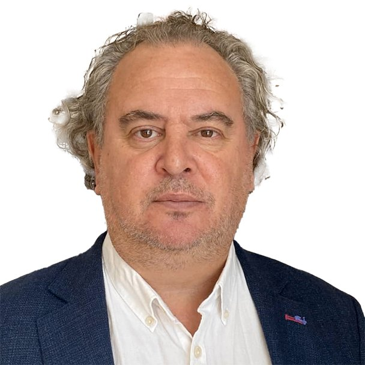

  <header class="found-header">
    

      <button type="button" class="lang-btn active" data-lang="en">EN</button>
      <button type="button" class="lang-btn" data-lang="es">ES</button>
    

    

    

    

      
FOUND{Team · Advisors}

      <h1>Luis Fondebrider</h1>
    

  </header>
  <a class="bio-back" href="/team/" data-en="← Back to Team" data-es="← Volver al equipo">← Back to Team</a>
  <article class="bio-card">
    
    

    
Forensic Anthropology Advisor

    

      
Luis Fondebrider is an Argentine forensic anthropologist known worldwide for investigating human rights violations and for helping to find and identify people who were forcibly disappeared.

      
He co-founded the Argentine Forensic Anthropology Team (EAAF) and led it as president until 2021. From 2021 to 2022 he headed the Forensic Unit of the International Committee of the Red Cross (ICRC).

      
In more than four decades of work he has led forensic investigations in over 65 countries, in settings of armed conflict and of political, ethnic and migration-related violence. Courts, United Nations commissions, human rights organisations and governments have sought his advice on more than 1,200 cases.

      
His work goes beyond fieldwork. He also helps shape international protocols and policies on human rights and transitional justice. In 2020 the EAAF was nominated for the Nobel Peace Prize.

    

    

      
Luis Fondebrider es un antropólogo forense argentino con reconocimiento internacional por su labor en la investigación de violaciones a los derechos humanos y en la búsqueda e identificación de personas víctimas de desaparición forzada.

      
Es cofundador del Equipo Argentino de Antropología Forense (EAAF), que presidió hasta 2021. Entre 2021 y 2022 dirigió la Unidad Forense del Comité Internacional de la Cruz Roja (CICR).

      
En más de cuatro décadas de trayectoria ha encabezado investigaciones forenses en más de 65 países, en contextos de conflicto armado y de violencia política, étnica y vinculada a la migración. Tribunales, comisiones de Naciones Unidas, organizaciones de derechos humanos y gobiernos han recurrido a su asesoría en más de 1,200 casos.

      
Su trabajo va más allá del campo. También contribuye a definir protocolos y políticas internacionales en materia de derechos humanos y justicia transicional. En 2020, el EAAF fue nominado al Premio Nobel de la Paz.

    

    

  </article>

