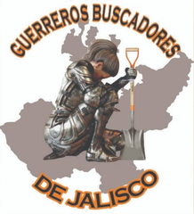
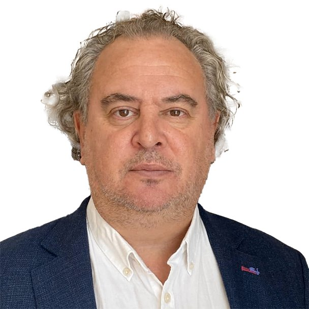

<meta name="viewport" content="width=1200">

  <header class="found-header">
      

        <button type="button" class="lang-btn active" data-lang="en">EN</button>
        <button type="button" class="lang-btn" data-lang="es">ES</button>
      

      

      

      

        
FOUND · Team

        <h1 id="team-title">Our Team</h1>
      

    </header>
  

    
FOUND{Team}&middot;Our core team brings together search collectives of Mexico and Colombia, CentroGeo, the University of Oxford, Jalisco’s Search Commission, the British Embassy in Mexico City, the National Autonomous University of Mexico (UNAM), and the Universidad de Guadalajara.

  

  

    <strong id="team-notice-label">Under construction</strong>
    This section is a work in progress. For now, you can reach us at miguel.moctezuma[@]found-project.org
  

  

    <h2 class="team-group-title" id="tg-direction">Direction</h2>
    

      

        MM
        
Miguel Moctezuma

        
Co-Founder &amp; Co-Director · University of Oxford

      

      

        JS
        
José Luis Silván

        
Co-Founder &amp; Co-Director · CentroGeo

      

      

        MG
        
Mariela Garfias

        
FCDO Pioneer

      

    

  

  

    <h2 class="team-group-title" id="tg-advisors">Advisors</h2>
    

      

        IN
        
        
Indira Navarro

        
Search Collective · Guerreros Buscadores

      

      

        GC
        
Guillermina Camacho

        
Search Collective · Siguiendo tu Rastro con Amor

      

      

        MM
        
María del Carmen Meza Ponce

        
Search Collective · Manos Buscadoras de Jalisco

      

      

        
        
<a href="/team/luis-fondebrider/">Luis Fondebrider</a>

        
Forensic Anthropology Advisor

        <a class="bio-link" href="/team/luis-fondebrider/" id="bio-fondebrider">Read bio →</a>
      

      

        VÁ
        
Victor Hugo Ávila Barrientos

        
Jalisco Search Commission

      

      

        TC
        
Tunuary Chávez

        
Jalisco Search Commission

      

      

        LF
        
Luz Janeth Forero

        
Colombia Search Unit

      

      

        MP
        
Martha Lidia Pérez

        
Mexico Search Commission

      

      

        BE
        
Brad Evans

        
Ethics Advisor · University of Bath

      

      

        KG
        
Karina García

        
UWE Bristol

      

    

  

  

    <h2 class="team-group-title" id="tg-contributors">Contributors</h2>
    

      

        DV
        
David Vigoureux

        
Innovation Manager at Brink · FOUND Coach

      

      

        SF
        
Samuel Fookes

        
Innovation at DT Global · FOUND Coach

      

      

        MG
        
Magnus Green

        
FOUND Strategy &amp; External Affairs · Director, Istituto Fiorentino di Critica Culturale

      

      

        MF
        
Mercedes Fernández

        
FOUND Expert on Visual Cultures

      

      

        DN
        
Daniel Nájera-Betancourt

        
FOUND Documentalist

      

    

  

